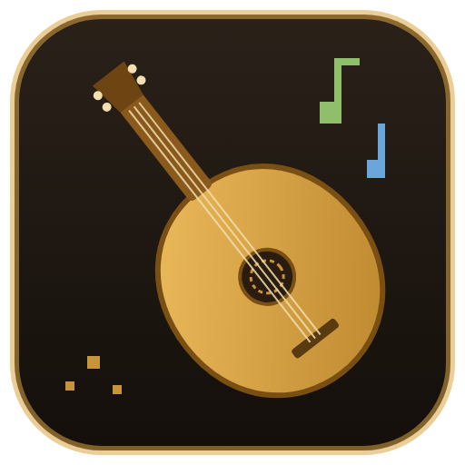

# MidiMCP

AI-controlled retro MIDI composer for 1990s-style fantasy RPG music.
Claude, Codex, Antigravity (or any MCP-capable agent) compose structured scores through an MCP server; a local app validates, plays, edits, and exports them.

Runs as one Docker container (designed for TrueNAS SCALE): a web UI at `/` (library, playback, tracks, exports, live updates), MCP over HTTP at `/mcp`, FluidSynth rendering, songs stored on a `/data` volume and downloadable as MIDI / WAV / JSON.

- **Deploy on TrueNAS:** [`docs/deploy/truenas.md`](docs/deploy/truenas.md)
- **Connect Claude Code / Codex / Antigravity:** [`docs/agents/connect-agents.md`](docs/agents/connect-agents.md)
- Design reference: [`docs/reference/`](docs/reference/README.md)
- Build order: [`docs/ROADMAP.md`](docs/ROADMAP.md)

## Refine generated music

Open a song and choose **Edit notes** beside a track, or **Edit notes / phrases**.
The piano roll supports click/Shift-click and box selection, drag to move notes,
and right-edge drag to resize selected notes together. Phrase mode selects bars
and provides scaling and velocity sliders. Changes save as new revisions.

**Multiply note lengths** keeps note starts fixed. **Stretch time and lengths**
also spreads note starts, anchored at the first selected note; enable timeline
extension to grow the song instead of clipping notes. Existing expression and
controller curves stay at their original times, as the editor warns.

Preview a selection as a temporary exact loop, save a bar-aligned song loop,
undo/redo local edits, and protect a passage or entire track from further edits.
**Copy selection for AI** creates a prompt for your connected agent; it includes
the exact notes and revision and preserves material outside the selection.

## Run with Docker (any host)

```bash
cp .env.example .env
```

Optionally set `MIDIMCP_TOKEN` in `.env`; if empty, a token is generated on first start (printed in the logs, saved to `data/token.txt`). Then:

```bash
docker compose up -d --build
```

```bash
curl http://localhost:8765/healthz
```

```bash
python scripts/smoke_test.py --url http://localhost:8765 --token YOUR_TOKEN
```

## Development

Requires Python 3.11+.

Windows (PowerShell):

```powershell
py -m venv .venv
.venv\Scripts\Activate.ps1
python -m pip install -e ".[dev]"
python -m pytest
python -m ruff check .
python -m ruff format --check .
```

Linux / macOS:

```bash
python3 -m venv .venv
source .venv/bin/activate
python -m pip install -e ".[dev]"
python -m pytest
python -m ruff check .
python -m ruff format --check .
```

Tests that render audio need `fluidsynth` and the FluidR3 GM soundbank (Ubuntu/Debian: `sudo apt install fluidsynth fluid-soundfont-gm`); they are skipped when missing. Run the server locally without Docker:

```bash
MIDIMCP_TOKEN=dev-token-0123456789 MIDIMCP_DATA_DIR=./data python -m midimcp serve
```

Tracks can also use the bundled VSCO Community Edition sampled flute through sfizz. In the track's **Sound source** selector, choose the controlled-vibrato or recorded-vibrato flute; other tracks can keep the project GM bank. WAV/MP3 preserve the sampled sound; MIDI uses the track's fallback GM instrument. Project JSON remembers the pinned source but does not contain the sample files. Scores with sampler bindings use schema 1.2 and require an updated MidiMCP.

The Docker image builds sfizz and provisions verified samples automatically. For native development, install `sfizz_render`, set `MIDIMCP_SFIZZ` to its executable path, run `python scripts/provision-samplers.py ./data/samplers`, and use the same data directory when starting the app. `MIDIMCP_SAMPLER_DIR` overrides the sample location. See [sampler provenance and rendering details](src/midimcp/sampler_assets/PROVENANCE.md).

In **Edit notes → Flute performance**, set phrase levels, held-note swell, vibrato, breath spacing and timing/velocity variation, then apply explicitly. The edit is one undoable revision. Recorded vibrato cannot be removed with the vibrato control, and these flute samples do not include recorded legato transitions. Note moves/resizes leave existing controller curves at their original ticks; reapply expression when needed. Hover a note's right edge to highlight its resize grip, then drag to snap the end to the selected grid step.

There is no hosted CI (GitHub Actions is intentionally not used). Run the lint and test commands above before every pull request.

Browser UI tests need Node.js 20+ and, for the end-to-end run, Playwright with Chromium (skipped when missing):

```bash
node --test web-tests/*.test.mjs
```

## Example songs

`examples/` holds complete songs written through the MCP tools (the same calls an AI client makes), so you can hear what a template can do and use them as a starting point:

- [`examples/old_realm_deep_forest.py`](examples/old_realm_deep_forest.py): "My Old Realm: Deep Forest Theme" from the `old-realm-forest` template.

Run one inside the container on the NAS (it reads the token from `/data/token.txt`):

```bash
cd /mnt/POOL/midimcp/src
sudo docker exec -i $(sudo docker ps -qf name=midimcp) python - < examples/old_realm_deep_forest.py
```
